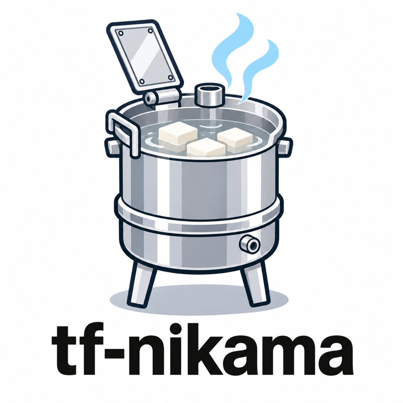

# tf-nikama

<p align="center">
  
</p>

GitHub プルリクエスト向けの、バックエンド不要な Terraform / OpenTofu 自動化ツールです。
GitHub Actions の中で動く、小さな単一バイナリとして提供します。

`nikama` は [Digger](https://github.com/diggerhq/digger) の *バックエンドレスモード*
（`no-backend: true`）を Rust で再実装したものです。設定キー、コメントコマンド、
ロックのスキーマ、plan の保存形式は Digger と互換性があるため、既存の Digger の
構成をそのまま置き換えるドロップインリプレースメントとして使えます。

## クイックスタート

`.github/workflows/nikama.yml`:

```yaml
name: nikama
on:
  pull_request:
    types: [opened, synchronize, reopened, closed, ready_for_review, converted_to_draft]
  issue_comment:
    types: [created]

permissions:
  contents: read
  pull-requests: write
  statuses: write
  id-token: write

concurrency:
  group: nikama-${{ github.event.pull_request.number || github.event.issue.number }}
  cancel-in-progress: false

jobs:
  nikama:
    runs-on: ubuntu-latest
    # Skip the runner for comments from outside the repository; nikama checks
    # the commenter's write access itself (see docs/CONFIGURATION.md).
    if: >-
      github.event_name != 'issue_comment'
      || contains(fromJSON('["OWNER", "MEMBER", "COLLABORATOR"]'), github.event.comment.author_association)
    steps:
      - uses: actions/checkout@v7
        with:
          ref: ${{ github.event_name == 'issue_comment' && format('refs/pull/{0}/merge', github.event.issue.number) || '' }}
      - uses: hashicorp/setup-terraform@v4
        with:
          terraform_wrapper: false
      - uses: aws-actions/configure-aws-credentials@v6
        with:
          role-to-assume: arn:aws:iam::123456789012:role/nikama
          aws-region: ap-northeast-1
      - uses: kangaechu/tf-nikama@v0.3.0
        with:
          upload-plan-destination: aws
          upload-plan-destination-s3-bucket: my-plan-bucket
```

PR ロックはAWSの場合、デフォルトで DynamoDB テーブル（`DiggerDynamoDBLockTable`、初回利用時に
作成）を使います。すべてを S3 に置きたい場合は `lock-provider: s3` と
`aws-lock-bucket` を設定してください。その場合、ロールにはそのバケットに対する
`s3:PutObject`、`s3:GetObject`、`s3:DeleteObject`、`s3:ListBucket` が必要で、
DynamoDB の権限は不要です。ロック用
バケットは plan 用バケットと兼用できます。

```yaml
      - uses: kangaechu/tf-nikama@v0.3.0
        with:
          lock-provider: s3
          aws-lock-bucket: my-lock-bucket
          upload-plan-destination: aws
          upload-plan-destination-s3-bucket: my-plan-bucket
```

Google Cloud では、AWS の認証ステップを `google-github-actions/auth` に置き換え、
アクションの向き先を Cloud Storage のバケットにします（サービスアカウントには両方の
バケットに対する `roles/storage.objectUser` が必要です）:

```yaml
      - uses: google-github-actions/auth@v3
        with:
          workload_identity_provider: projects/123456789012/locations/global/workloadIdentityPools/github/providers/github
          service_account: nikama@my-project.iam.gserviceaccount.com
      - uses: kangaechu/tf-nikama@v0.3.0
        with:
          lock-provider: gcp
          google-lock-bucket: my-lock-bucket
          upload-plan-destination: gcp
          upload-plan-destination-gcp-bucket: my-plan-bucket
```

リポジトリルートの `nikama.yml`:

```yaml
projects:
  - name: network
    dir: infra/network
  - name: app
    dir: infra/app
    depends_on: [network]

concurrency:
  max_parallel: 4
```

実行の流れ（ロック、apply の条件、自動マージ）と、誰が実行を開始でき何を実行して
よいかは [`docs/CONFIGURATION.ja.md`](docs/CONFIGURATION.ja.md)、アクションの入力・
`nikama.yml` のキー・環境変数の一覧は [`docs/PARAMETERS.ja.md`](docs/PARAMETERS.ja.md)、
スキーマの全体は [`examples/nikama.yml`](examples/nikama.yml) を参照してください。

Digger から移行する場合は [`docs/MIGRATION.ja.md`](docs/MIGRATION.ja.md) を参照してください。

## Digger にない機能

Digger のバックエンドレスモードでできることに加えて:

- **大きなリポジトリでも結果が早く返る**: プロジェクトを 1 つずつではなく並列に plan します。
- **読みやすい plan / apply 結果**: 実行ごとに 1 件のコメントにまとめ、プロジェクトの完了に合わせて更新します。
- **クラウドリソースが減る**: AWSではロックを S3 バケットにも置けるので、DynamoDB テーブルが不要になります。
- **plan が同僚をブロックしない**: `pr_locks: on_apply` にすると複数の PR が同じプロジェクトを plan でき、ロックを取るのは apply だけになります。
- **依存更新の PR が誰も止めない**: Renovate / Dependabot の PR は、ロックを 1 つも持たずに全ディレクトリを plan します。
- **コメントから対象を絞った plan**: ワークフローを編集せずに、`nikama plan -- ...` で `-target` / `-replace` を許可リストの範囲で渡せます。
- **モジュールの変更を見逃さない**: ローカルモジュールの変更で、それを使うすべてのプロジェクトが plan されます。
- **1 つのディレクトリで複数環境**: プロジェクトの `branch` 正規表現で、staging / production のワークスペースをそれぞれのベースブランチに結びつけます。
- **ドラフトは静かなまま**: ドラフト PR はレビュー準備完了になるまで何も実行せず、ロックも持ちません。
- **古い plan を apply しない**: 保存した plan は生成元のコミットに紐づき、別のコミットでは拒否されます。
- **外部の人に Terraform を実行させない**: コメントコマンドと承認は書き込み権限のあるユーザーのものだけが有効で、`config-ref` / `allowed-providers` により PR がジョブの認証情報で実行される内容を変えられません。

次のものには対応しておらず、設定読み込み時に拒否されます: Terragrunt、Pulumi、
Azure のロック／plan 保存、GitHub Artifacts への plan 保存、OPA ポリシー、Digger
バックエンドの機能。AWS と Google Cloud 上の Terraform / OpenTofu 以外に対応する
予定はありません。

## コントリビューション

バグ報告と機能要望は
[GitHub Issues](https://github.com/kangaechu/tf-nikama/issues/new) で受け付けて
います。プルリクエストはリポジトリのコラボレーターからのみ受け付け、それ以外の
アカウントからの PR は自動的にクローズされます。[CONTRIBUTING.md](CONTRIBUTING.md)
を参照してください。

## 謝辞

tf-nikama は、Digger HQ による Apache-2.0 ライセンスの
[Digger](https://github.com/diggerhq/digger) のバックエンドレスモードを独立して
再実装したものです。既存の構成を移行できるよう、設定キー、コメントコマンド、
DynamoDB と Cloud Storage のロックスキーマ、plan オブジェクトキーの形式は互換性を
保っています。

## ライセンス

Apache License 2.0。[LICENSE](LICENSE) を参照してください。
