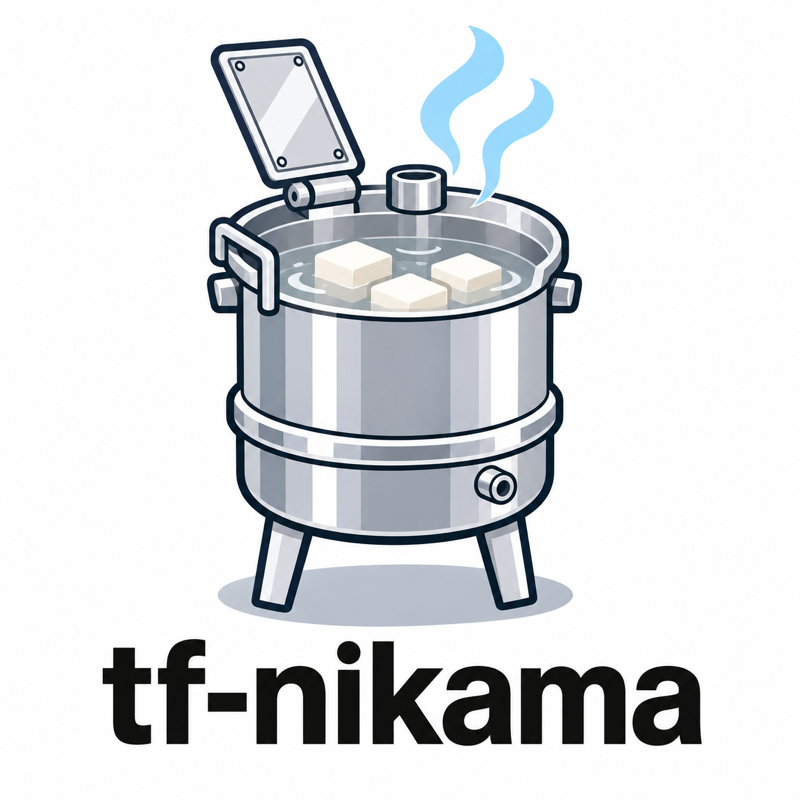

# tf-nikama

<p align="center">
  
</p>

<p align="center">
  <a href="https://github.com/kangaechu/tf-nikama/actions/workflows/ci.yml"></a>
  <a href="https://github.com/kangaechu/tf-nikama/releases/latest"></a>
  <a href="LICENSE"></a>
</p>

[日本語版 README](README.ja.md)

**Terraform / OpenTofu plan and apply on GitHub pull requests, with nothing
to host.**

No Atlantis server to run, no Terraform Cloud subscription, no orchestrator
backend. nikama is a single binary (about 5 MB to download) that runs inside
your GitHub Actions job: a push plans the impacted projects, a comment applies them, and a bucket
or table in your own cloud account holds the locks and plan files.

It is a Rust re-implementation of the *backendless mode* of
[Digger](https://github.com/diggerhq/digger) and a drop-in replacement for
it: configuration keys, comment commands, lock schemas and plan storage are
compatible.

## What it looks like

Every run posts one comment and keeps editing it until the last project is
done:

> ### nikama plan · run [#1234](#) · 2026-11-11T09:30:12Z
>
> | Project | Status | + | ~ | - | ± |
> |---|---|---|---|---|---|
> | network | ✅ no changes | 0 | 0 | 0 | 0 |
> | app | 🟡 changes | 2 | 1 | 0 | 0 |
> | batch | 🔒 locked by #1230 | | | | |
>
> <details><summary><b>app</b> · plan output</summary>
>
> ```
> Terraform will perform the following actions:
>   + aws_sqs_queue.events
>   + aws_lambda_event_source_mapping.events
>   ~ aws_lambda_function.worker
> ```
> </details>
>
> ---
> `nikama apply` · `nikama apply -p <project>` · `nikama unlock` · `nikama help`

## Day to day

1. **Open or push to a pull request.** nikama plans every project the
   changed files touch, posts the comment above and sets the `digger/plan`
   commit status.
2. **Comment `nikama apply`.** Once the PR is mergeable (and approved, if you
   require it) the stored plans are applied in dependency order and the
   `digger/apply` status turns green.
3. **Merge.** The locks the PR held are released. With `auto_merge: true`
   nikama merges for you after a successful apply.

| Comment | What it does |
|---|---|
| `nikama plan` | Plan every impacted project |
| `nikama plan -p app` | Plan one project (`-p` repeats; `-d <dir>` selects by directory) |
| `nikama plan --no-lock` | Plan without taking locks, for a look at the plan |
| `nikama plan -p app -- -target=module.vpc` | Pass allowlisted arguments to `terraform plan` |
| `nikama apply` / `nikama apply -p app` | Apply every impacted project, or one |
| `nikama unlock` | Release every lock this PR holds |
| `nikama help` | Show the command list |

`digger` works in place of `nikama`, and `wakeup_word` sets your own.

## What nikama adds

Everything Digger's backendless mode does, plus:

- **Faster feedback on large repositories**: projects plan in parallel instead of one after another.
- **Readable plan / apply results**: one comment per run, updated in place as projects finish.
- **Fewer cloud resources**: on AWS, locks can also live in an S3 bucket, so no DynamoDB table is needed.
- **Planning never blocks a colleague**: with `pr_locks: on_apply`, several PRs can plan the same project and only the apply takes the lock.
- **Dependency bumps block nobody**: Renovate / Dependabot PRs plan every directory without holding a single lock.
- **Targeted plans from a comment**: pass `-target` / `-replace` with `nikama plan -- ...`, within an allowlist you define, without editing the workflow.
- **Module changes are not missed**: a change to a local module plans every project that uses it.
- **One directory, several environments**: a project's `branch` regex ties staging and production workspaces to their base branches.
- **Drafts stay quiet**: a draft PR runs nothing and holds no locks until it is marked ready for review.
- **Never apply a stale plan**: a stored plan is tied to the commit it came from and refused for any other.
- **Outsiders cannot run your Terraform**: comment commands and approvals only count from users with write access, and `config-ref` / `allowed-providers` stop a PR from changing what runs with the job's credentials.

## Quick start

You need an AWS role the workflow can assume through OIDC, with access to an
S3 bucket for plan files and to a DynamoDB lock table that nikama creates on
first use. Google Cloud, S3-only locks and the required permissions are in
[`docs/CONFIGURATION.md`](docs/CONFIGURATION.md#lock-and-plan-storage-providers).

`.github/workflows/nikama.yml`:

```yaml
name: nikama
on:
  pull_request:
    types: [opened, synchronize, reopened, closed, ready_for_review, converted_to_draft]
  issue_comment:
    types: [created]

permissions:
  contents: read
  pull-requests: write
  statuses: write
  id-token: write

concurrency:
  group: nikama-${{ github.event.pull_request.number || github.event.issue.number }}
  cancel-in-progress: false

jobs:
  nikama:
    runs-on: ubuntu-latest
    # Skip the runner for comments from outside the repository; nikama checks
    # the commenter's write access itself.
    if: >-
      github.event_name != 'issue_comment'
      || contains(fromJSON('["OWNER", "MEMBER", "COLLABORATOR"]'), github.event.comment.author_association)
    steps:
      - uses: actions/checkout@v7
        with:
          ref: ${{ github.event_name == 'issue_comment' && format('refs/pull/{0}/merge', github.event.issue.number) || '' }}
      - uses: hashicorp/setup-terraform@v4
        with:
          terraform_wrapper: false
      - uses: aws-actions/configure-aws-credentials@v6
        with:
          role-to-assume: arn:aws:iam::123456789012:role/nikama
          aws-region: ap-northeast-1
      - uses: kangaechu/tf-nikama@v0.3.0
        with:
          upload-plan-destination: aws
          upload-plan-destination-s3-bucket: my-plan-bucket
```

`nikama.yml` at the repository root:

```yaml
projects:
  - name: network
    dir: infra/network
  - name: app
    dir: infra/app
    depends_on: [network]
```

Open a pull request that touches `infra/app` and you get the comment above.

**Read on**

- [`docs/CONFIGURATION.md`](docs/CONFIGURATION.md): how a run works (locks, apply requirements, auto-merge), lock and plan storage providers, who can start a run and what it may execute.
- [`docs/PARAMETERS.md`](docs/PARAMETERS.md): every action input, `nikama.yml` key and environment variable with its default.
- [`examples/nikama.yml`](examples/nikama.yml): the full configuration schema.
- [`docs/MIGRATION.md`](docs/MIGRATION.md): switching over from Digger.

## Not supported

Terragrunt, Pulumi, Azure lock or plan storage, GitHub Artifacts plan
storage, OPA policies and Digger backend features are rejected at config
load. There are no plans to go beyond Terraform / OpenTofu on AWS and Google
Cloud.

## Contributing

Bug reports and feature requests are welcome as
[GitHub Issues](https://github.com/kangaechu/tf-nikama/issues/new). Pull
requests are accepted from repository collaborators only; PRs from other
accounts are closed automatically. See [CONTRIBUTING.md](CONTRIBUTING.md).

## Acknowledgements

tf-nikama is an independent re-implementation of the backendless mode of
[Digger](https://github.com/diggerhq/digger) by Digger HQ, licensed under
Apache-2.0.

## License

Apache License 2.0. See [LICENSE](LICENSE).
